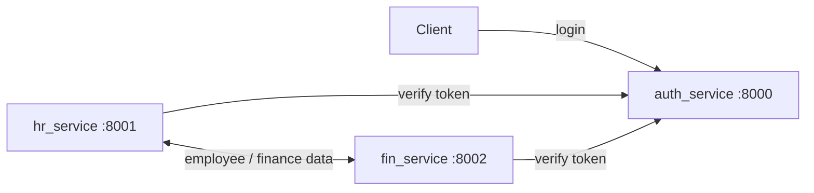

# HR Service

A Django-based Human Resources microservice that manages HR-related data.  
It integrates with **Auth Service** and **Finance Service**, uses multiple databases, and provides REST APIs with built-in documentation.

---

## 📑 Table of Contents
- [Introduction](#introduction)  
- [Architecture](#architecture)  
- [Features](#features)  
- [Project Structure](#project-structure)  
- [Installation](#installation)  
- [Configuration](#configuration)  
- [Usage](#usage)  
- [API Documentation](#api-documentation)  
- [Dependencies](#dependencies)  
- [Troubleshooting](#troubleshooting)  
- [Contributors](#contributors)  
- [License](#license)  

---

## 🚀 Introduction
This project provides an **HR Service** as part of a microservices system.  
It integrates with:
- **Auth Service** (`http://localhost:8000`) for authentication and token validation  
- **Finance Service** (`http://localhost:8002`) for finance-related data exchange  

The service relies on Django REST Framework and **drf-spectacular** for schema generation and API documentation.

---

## Architecture



The three services run separately; the ports above are the defaults from the example `local_settings.py`. The example configuration uses SQLite for local development. For a gateway-level example (per-field permissions, GraphQL, Redis Streams fan-out), see [graphql-gateway-demo](https://github.com/TaeseobK/graphql-gateway-demo).

## ✨ Features
- **Token-based authentication** via Auth Service  
- **Integration with Finance Service**  
- **Multiple databases**:  
  - `hr_master` – master HR database  
  - `hr_dump` – dump/reporting HR database  
- **Database routers** (`HrMasterRouter`, `HrDumpRouter`) for routing queries  
- **Custom authentication middleware** (`VerifyAuthMiddleware`, `AuthServiceLogoutMiddleware`)  
- **OpenAPI-based API Documentation**  

---

## 📂 Project Structure
```
hr_service/
│── hr/                    # Django project root
│   ├── settings.py        # Main Django settings
│   ├── local_settings.py  # Environment-specific overrides
│   ├── urls.py            # URL routes
│   ├── wsgi.py            # WSGI entry point
│── hr_master/             # Master HR database app
│── hr_dump/               # Dump HR database app
│── hr/core/               # Core logic and utilities
│── databases/             # SQLite databases (default, hr_master, hr_dump)
│── keys/                  # Warning and key files
```

---

## ⚙️ Installation

1. **Clone the repository**
   ```bash
   git clone https://github.com/TaeseobK/hr_service.git
   cd hr_service
   ```

2. **Create and activate a virtual environment**
   ```bash
   python -m venv venv
   source venv/bin/activate   # Linux/Mac
   venv\Scripts\activate      # Windows
   ```

3. **Install dependencies**
   ```bash
   pip install -r requirements.txt
   ```

4. **Create migration files**
   ```bash
   python manage.py makemigrations
   ```

4. **Run database migrations**
   ```bash
   python manage.py migrate
   python manage.py migrate hr_master --database=hr_master
   python manage.py migrate hr_dump --database=hr_dump
   ```

5. **Start the development server**
   ```bash
   python manage.py runserver
   ```

---

## 🔧 Configuration
Local and environment-specific settings go in `local_settings.py`.  

Example:
```python
AUTH_SERVICE = 'http://localhost:8000'
FIN_SERVICE = 'http://localhost:8002'

DATABASE_SERVICE = {
    'default': {
        'ENGINE': 'django.db.backends.sqlite3',
        'NAME': BASE_DIR / 'databases/auth.sqlite3',
    },
    'hr_master': {
        'ENGINE': 'django.db.backends.sqlite3',
        'NAME': BASE_DIR / 'databases/hr_master.sqlite3',
    },
    'hr_dump': {
        'ENGINE': 'django.db.backends.sqlite3',
        'NAME': BASE_DIR / 'databases/hr_dump.sqlite3',
    }
}

DEBUG_ = True
```

---

## ▶️ Usage
- Access service at:  
  ```
  http://127.0.0.1:8000/
  ```
- Include **Auth Token** in request headers:  
  ```
  Authorization: Token <your_token>
  ```

---

## 📖 API Documentation
- Swagger/OpenAPI documentation:  
  ```
  http://127.0.0.1:8000/api/schema/swagger-ui/
  ```
- JSON schema:  
  ```
  http://127.0.0.1:8000/api/schema/
  ```

---

## 📦 Dependencies
Key dependencies include:
- **Django 5.2.5**  
- **Django REST Framework**  
- **drf-spectacular** & **drf-spectacular-sidecar**  
- **django-filters**  

---

## 🛠 Troubleshooting
- Ensure **Auth Service** and **Finance Service** are running and accessible.  
- Databases must exist under `databases/`. Run `migrate` if missing.  
- If docs don’t load, check `drf-spectacular` installation and schema settings.  

---

## 👥 Contributors
- Afrizal Bayu Satrio (Initial Project and Maintainer)  

---

## 📜 License
This project is licensed under the [Unlicense](LICENSE).  
